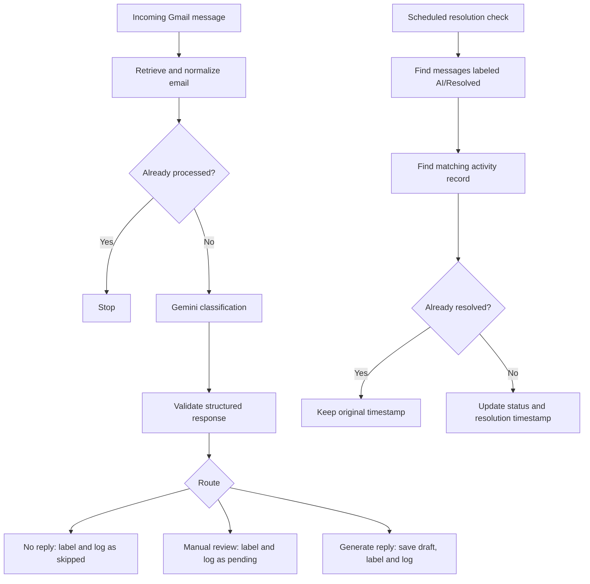
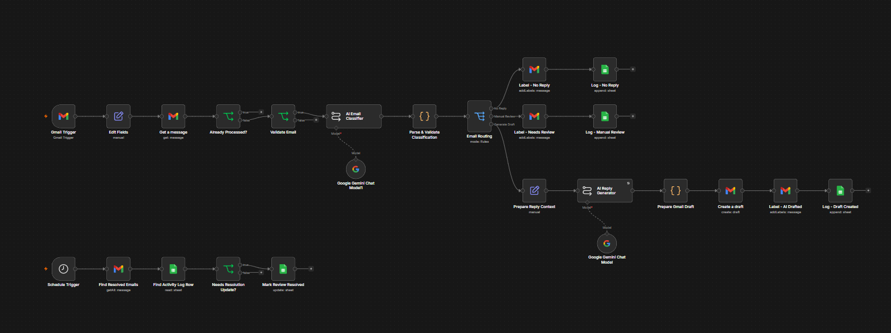

# AI Email Triage & Draft Assistant

## With Human Review Tracking

An n8n portfolio prototype that classifies incoming email, prepares reply drafts, flags requests for human review, and tracks their resolution in Google Sheets.

**Stack:** n8n, Google Gemini, Gmail, Google Sheets.

**Status:** Shareable 25-node workflow exported from the existing n8n prototype, with account references replaced by setup placeholders. It imported successfully into an isolated n8n 2.47.3 instance and remained inactive. Connect your own credentials to run it. Local regression checks pass; a clean-import run against Gmail, Gemini, and Sheets remains to be performed.

## Demo and case study

Visit [Build with Hanz](https://buildwithhanz.vercel.app), open Projects, and explore **AI Email Triage & Draft Assistant**. The case study includes a recorded demo, workflow screenshot, technical challenge, and sample-email simulation. The browser simulation uses sample data and does not connect to a visitor's Gmail account.

## The problem

Routine inquiries, promotional emails, and sensitive requests share an inbox but need different treatment. This prototype reduces repetitive sorting while leaving outgoing replies and sensitive decisions under human control.

## Workflow overview

## Repository contents

| Path | Purpose |
| --- | --- |
| `workflows/email-triage-assistant.json` | Sanitized, inactive n8n workflow export |
| `docs/SETUP.md` | Import, credentials, and configuration checklist |
| `docs/TESTING.md` | Manual reproduction scenarios and evidence record |
| `docs/LIMITATIONS.md` | Current constraints and deferred improvements |
| `examples/sample-emails.json` | Synthetic messages and expected routing |
| `examples/test-run.csv` | Blank test record; no execution results claimed |
| `examples/activity-log-headers.csv` | Spreadsheet column headers taken from the export |
| `tests/workflow.test.mjs` | Tests of the actual exported JavaScript and routing expressions |

## Getting started

Follow [the setup checklist](docs/SETUP.md). Test in a dedicated inbox and spreadsheet before activating scheduled processing.

To run the credential-free regression checks with Node.js 22 or later, use `npm test`. There are no npm dependencies to install. These tests evaluate exported node code and expressions with synthetic inputs; they do not contact Google services.

## My contribution

As described in the portfolio case study, I configured the n8n workflow, connected Gmail, Gemini, and Google Sheets, refined the classification prompt, implemented JavaScript response validation, and tested the routing and resolution logic.

An issue I debugged was a missing email body after an intervening node changed the available fields. I updated the prompt references to read the sender, subject, and body from the normalization node. I also added a status check so repeated resolution runs preserve the original resolution timestamp.

The repository documentation, sanitization, and regression checks were prepared with AI assistance. The shareable template makes two explicit configuration changes: the duplicate check uses the three configured processing-label placeholders, and the resolution schedule explicitly sets a five-minute interval. The original downloaded export is unchanged.

## Results and limitations

The case study reports controlled checks of labels, drafts, spreadsheet entries, duplicate handling, and resolution tracking. This repository currently contains expected outcomes, not independently recorded executions. No accuracy percentage or time-saved estimate has been measured here.

See [testing](docs/TESTING.md) and [limitations](docs/LIMITATIONS.md) for the scope of the prototype and planned reliability work.
